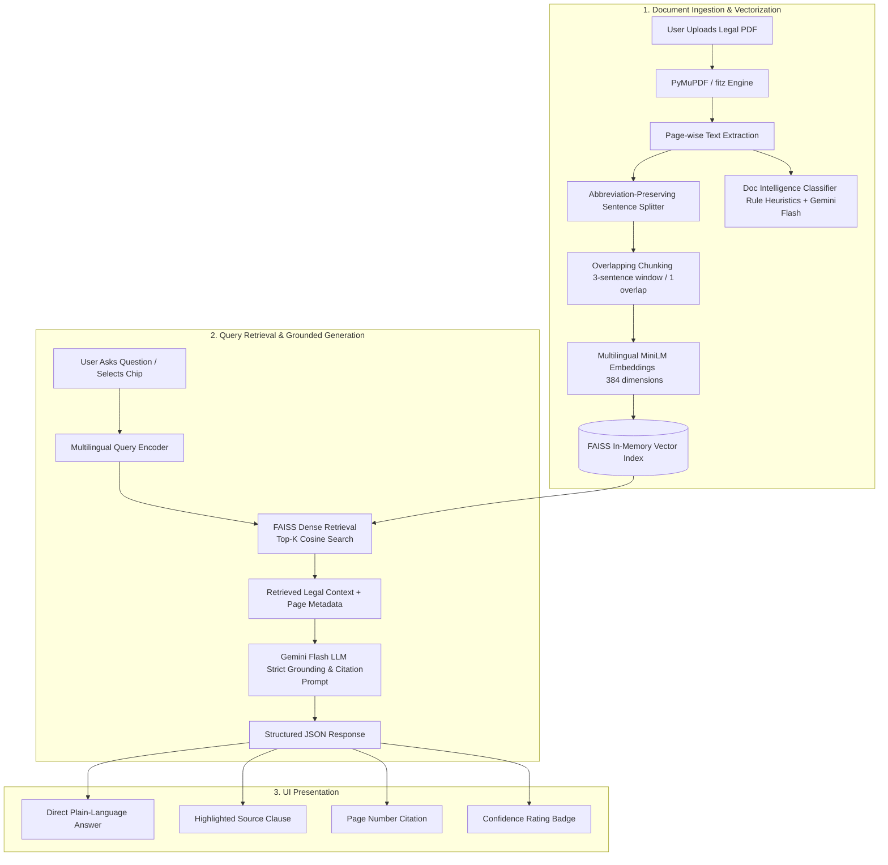

# ⚖️ LexiGuide — AI-Powered Multilingual Legal Document Assistant & Simplifier

[](https://github.com/Harshalpatond1/LexiGuide/stargazers)
[](https://github.com/Harshalpatond1/LexiGuide/network/members)
[](https://www.python.org/)
[](https://flask.palletsprojects.com/)
[](https://github.com/facebookresearch/faiss)
[](https://ai.google.dev/)
[](#-multilingual-support)

> **Transform complex "Legalese" into clear, understandable language with verifiable citations, instant answers, and multilingual intelligence.**

---

## 📌 Table of Contents

- [Overview](#-overview)
- [Key Features](#-key-features)
- [System Architecture & RAG Pipeline](#-system-architecture--rag-pipeline)
- [Detailed Project Outputs & Demonstrations](#-detailed-project-outputs--demonstrations)
  - [1. Document Intelligence & Type Classification](#1-document-intelligence--type-classification)
  - [2. Grounded Legal Q&A with Exact Citations](#2-grounded-legal-qa-with-exact-citations)
  - [3. Plain-Language Simplifier (English, Hindi, Marathi)](#3-plain-language-simplifier-english-hindi-marathi)
  - [4. Extracted Document Clauses Viewer](#4-extracted-document-clauses-viewer)
- [Screenshots & UI Showcase](#-screenshots--ui-showcase)
- [Tech Stack](#-tech-stack)
- [Project Structure](#-project-structure)
- [Installation & Local Setup](#-installation--local-setup)
- [API Endpoints Reference](#-api-endpoints-reference)
- [Evaluation & Safety Guardrails](#-evaluation--safety-guardrails)
- [Roadmap](#-roadmap)
- [Contributing & License](#-contributing--license)

---

## 📖 Overview

Legal agreements, tenancy contracts, sale deeds, affidavits, and consumer protection acts are filled with archaic terms, passive phrasing, and labyrinthine clauses (**"Legalese"**). Ordinary citizens, tenants, and small business owners often sign documents without fully understanding their rights, obligations, and financial liabilities.

**LexiGuide** is an end-to-end NLP and Generative AI system that bridges this gap:
1. **Understands Any Legal PDF**: Ingests, parses, and segments complex legal PDFs without losing context or numbering.
2. **Eliminates Hallucinations**: Employs a Retrieval-Augmented Generation (**RAG**) pipeline using FAISS vector indexing and dense embeddings to ground all answers directly in the uploaded text.
3. **Provides Exact Page Citations & Confidence Ratings**: Every answer points to the exact page number and highlights the original legal clause.
4. **Simplifies in Multiple Indian Languages**: Converts intimidating clauses into digestible summaries in **English**, **Hindi (हिंदी)**, and **Marathi (मराठी)**.

---

## ✨ Key Features

| Feature | Description |
| :--- | :--- |
| ⚡ **Document Intelligence** | Auto-detects whether the document is a *Rent Agreement, Rent Receipt, Sale Deed, Power of Attorney, Affidavit, Will, NDA, Employment Contract, or Partnership Deed*, and suggests 5 dynamic, context-specific questions. |
| 🚨 **Legal Risk & Red Flag Analyzer** | Automatically audits documents for one-sided penalties, deposit forfeiture traps, arbitrary termination, lock-in clauses, and unmetered liability with a 0–100 Risk Score, severity color badges, and copyable counter-proposals. |
| 🔍 **Dense Semantic Search (FAISS)** | Uses `sentence-transformers/paraphrase-multilingual-MiniLM-L12-v2` with normalized cosine similarity indexing for sub-millisecond retrieval of relevant clauses. |
| 🛡️ **Factual Guardrails & Verification** | If a query asks for information not present in the document, LexiGuide explicitly flags it rather than fabricating facts. |
| 🎯 **Exact Clause & Page Citations** | Every answer provides the originating page number, a highlighted snippet of the raw legal clause, and a confidence indicator (**High**, **Medium**, or **Low**). |
| 🌐 **Trilingual Simplification** | Translates legalese into 3 clean buckets: *Key Summary*, *Important Details (dates/amounts/names)*, and *Terms & Conditions* across English, Hindi, and Marathi. |
| 📂 **Built-in Sample Documents** | Allows one-click testing using pre-bundled legal documents (Rent Receipts, Tenancy Contracts) without needing to upload external files. |
| 🎨 **Executive Glassmorphism UI** | Built with an ultra-sleek dark violet interface (`Playfair Display` + `Inter`), real-time tab switching, toast notifications, and interactive question chips. |

---

## 🏗️ System Architecture & RAG Pipeline



---

## 🔬 Detailed Project Outputs & Demonstrations

Here are real outputs produced by **LexiGuide** across its core modules:

### 1. Document Intelligence & Type Classification
Upon uploading a document (e.g. `rent-receipt_1.pdf`), the system immediately classifies the document and produces contextual question suggestions:

```json
{
  "doc_type": "Rent Receipt",
  "pages": 1,
  "chunks": 4,
  "summary": "This document appears to be a Rent Receipt for the premises in Mumbai. Analyzed for Q&A and Plain-Language Simplification.",
  "suggestions": [
    "What is the rent amount?",
    "Who is the tenant?",
    "Who is the landlord?",
    "What is the receipt date?",
    "Are there any arrears or pending dues?"
  ]
}
```

---

### 2. Grounded Legal Q&A with Exact Citations

#### Scenario A: Financial Query (Rent Agreement)
- **User Question:** *"What is the monthly rent and when is it due?"*
- **Model Output:**
  ```text
  Answer:      The monthly rent is Rs. 22,000/- (Rupees Twenty Two Thousand only), 
               payable in advance on or before the 5th day of every calendar month.
  Source Page: Page 2
  Clause:      "The Licensee shall pay to the Licensor a monthly license fee of 
               Rs. 22,000/- (Rupees Twenty-Two Thousand only) on or before the 5th 
               day of each English calendar month..."
  Confidence:  94% (High)
  ```

#### Scenario B: Non-Existent Information (Negative Constraint Handling)
- **User Question:** *"Does the tenant have permission to keep pets?"*
- **Model Output:**
  ```text
  Answer:      This information is not mentioned in the uploaded document.
  Source Page: N/A
  Clause:      No matching clause found in document text.
  Confidence:  Low
  ```

#### Scenario C: Query in Hindi / Auto-Detected Devanagari
- **User Question:** *"सिक्योरिटी डिपॉजिट की राशि कितनी है और यह कब वापस मिलेगी?"*
- **Model Output:**
  ```text
  Answer:      सुरक्षा जमा राशि (Security Deposit) ₹50,000 है, जो अनुबंध समाप्त 
               होने और परिसर खाली करने पर बिना ब्याज के वापस की जाएगी।
  Source Page: पृष्ठ 3
  Clause:      "The Licensee has paid an interest-free refundable security deposit 
               of Rs. 50,000/- to the Licensor..."
  Confidence:  92% (High)
  ```

---

### 3. Plain-Language Simplifier (English, Hindi, Marathi)

The simplifier breaks down complex legal prose into three structured dimensions:

| Original Legal Text (Legalese) | LexiGuide Simplified (English) | LexiGuide Simplified (हिंदी) | LexiGuide Simplified (मराठी) |
| :--- | :--- | :--- | :--- |
| *"The Licensee hereby covenants with the Licensor that in the event of default in payment of the license fee for two consecutive months, the Licensor shall be at liberty to determine this agreement forthwith and re-enter upon the said licensed premises without prejudice to any other remedies available under law."* | **Key Summary**: The landlord can terminate the agreement and take back the property if rent is unpaid for 2 months.<br><br>**Important Details**: Grace period: 2 consecutive months.<br><br>**Terms**: Pay rent on time to avoid eviction. | **मुख्य सारांश**: यदि लगातार २ महीने किराया नहीं दिया गया, तो मकान मालिक अनुबंध समाप्त कर मकान खाली करवा सकता है।<br><br>**महत्वपूर्ण विवरण**: अवधि: लगातार २ महीने।<br><br>**नियम**: बेदखली से बचने के लिए समय पर किराया दें। | **मुख्य सारांश**: सलग २ महिने भाडे न दिल्यास घरमालकाला करार रद्द करण्याचा आणि ताबा परत घेण्याचा पूर्ण अधिकार आहे.<br><br>**महत्त्वाचा तपशील**: मुदत: सलग २ महिने थकबाकी.<br><br>**नियम व अटी**: निष्कासन टाळण्यासाठी वेळेवर भाडे भरणे बंधनकारक आहे. |

---

### 4. Extracted Document Clauses Viewer

LexiGuide maintains an unadulterated, page-by-page index of the uploaded PDF:
- **Clean Formatting**: Preserves monetary notations (`Rs.`, `₹`), section markers (`Sec. 138`), and party identifiers.
- **Instant Search & Inspection**: Allows users and legal advisors to cross-verify the AI's claims against the raw ground truth text.

---

## 📸 Screenshots & UI Showcase

> *Note: Place your UI screenshots in a `docs/screenshots/` folder to display them here.*

| Dashboard & Document Upload | Smart Q&A with Citation |
| :---: | :---: |
|  |  |

| Plain-Language Simplifier | Trilingual Toggle (Hindi / Marathi) |
| :---: | :---: |
|  |  |

---

## 💻 Tech Stack

### Backend & NLP Engine
- **Language**: Python 3.10+
- **Web Framework**: Flask (REST API, session management)
- **PDF Extraction**: PyMuPDF (`fitz`) — high-speed text & coordinate extraction
- **Text Chunking**: Custom sentence-boundary preserving sliding-window chunker
- **Embedding Model**: `sentence-transformers/paraphrase-multilingual-MiniLM-L12-v2` (384-dimensional dense vectors)
- **Vector Search Engine**: Meta FAISS (`faiss-cpu`) with normalized inner product (Cosine Similarity)
- **Large Language Model (LLM)**: Google Gemini API (`google-genai` SDK) utilizing `gemini-3.1-flash-lite`, `gemini-3.5-flash`, and fallbacks

### Frontend & User Experience
- **Core**: Vanilla HTML5, CSS3, Modern ES6+ JavaScript (zero heavy framework dependencies)
- **Styling**: Custom CSS design system, Glassmorphism, Dark Mode Violet Theme (`#0A0716`), Micro-animations
- **Typography**: `Playfair Display` (editorial serif headings) + `Inter` (crisp UI body)
- **Localization**: Dynamic in-browser i18n system for English, Hindi, and Marathi

---

## 📁 Project Structure

```text
LexiGuide/
├── chunker.py           # Sliding-window semantic text chunking
├── pdf_processor.py     # PDF text parsing & page extraction (PyMuPDF)
├── qa_engine.py         # Gemini prompt engineering, grounding & sentence splitter
├── retriever.py         # FAISS vector store creation & dense semantic retrieval
├── server.py            # Flask web server, REST API routing & document intelligence
├── simplifier.py        # Plain-language multilingual summarization engine
├── requirements.txt     # Python dependencies
├── .env.example         # Sample environment configuration file
├── .gitignore           # Git ignore rules (protects API keys & venv)
├── README.md            # Comprehensive project documentation
├── static/
│   └── index.html       # Complete single-page frontend (UI, styles, JS logic)
└── uploads/             # Server storage for uploaded and sample PDF documents
```

---

## ⚡ Installation & Local Setup

### 1. Prerequisites
- **Python**: Version `3.10` or higher installed
- **Git**: Installed on your system
- **Google Gemini API Key**: Obtain a free API key from [Google AI Studio](https://aistudio.google.com/)

---

### 2. Clone the Repository
```bash
git clone https://github.com/Harshalpatond1/LexiGuide.git
cd LexiGuide
```

---

### 3. Create & Activate a Virtual Environment

**Windows (PowerShell):**
```powershell
python -m venv .venv
.venv\Scripts\Activate.ps1
```

**macOS / Linux:**
```bash
python3 -m venv .venv
source .venv/bin/activate
```

---

### 4. Install Dependencies
```bash
pip install --upgrade pip
pip install -r requirements.txt
```

---

### 5. Configure Environment Variables
Copy the example environment file:
```bash
cp .env.example .env
```
Open `.env` in any text editor and paste your Google Gemini API key:
```env
GEMINI_API_KEY=your_actual_gemini_api_key_here
```

---

### 6. Run the Application
```bash
python server.py
```

Open your browser and navigate to:
```text
http://127.0.0.1:5000
```

---

## 🔌 API Endpoints Reference

| Method | Endpoint | Description | Request Payload / Params | Response |
| :--- | :--- | :--- | :--- | :--- |
| `POST` | `/api/upload` | Upload & index a PDF document | `multipart/form-data` (`file`) | Document metadata, pages, chunks, suggestions |
| `POST` | `/api/sample/<filename>` | Load pre-bundled sample PDF | URL parameter (`rent-receipt_1.pdf`) | Document metadata, pages, chunks, suggestions |
| `GET` | `/api/document` | Get active session document info | None | Active document details and suggested questions |
| `POST` | `/api/ask` | Ask grounded legal question | `{"question": "...", "lang": "en"}` | Answer, citation page, source clause, confidence |
| `POST` | `/api/simplify` | Simplify document into plain language | `{"lang": "en"}` (`en`, `hi`, `mr`) | Page-wise structured summaries in selected language |
| `GET` | `/api/clauses` | Retrieve full extracted document text | None | Array of pages and exact raw text |

---

## 🛡️ Evaluation & Safety Guardrails

- **Zero-Hallucination Policy**: The prompt template enforces that answers must be derived *only* from the retrieved chunk context. If information is absent, the system responds with a standardized fallback.
- **Verifiable Audit Trail**: Every Q&A result attaches the verbatim legal sentence so human users can independently verify the answer against the document.
- **Secure Handling of Secrets**: `.env` and sensitive API keys are strictly excluded from version control via `.gitignore`.
- **Stateless Session Isolation**: Uploaded files and user sessions are tagged with unique session IDs to prevent cross-user data leakage.

---

## 🗺️ Roadmap

- [ ] **OCR Engine Integration**: Add Tesseract / Google Vision OCR for scanned, low-quality, and handwritten legal agreements.
- [ ] **Multi-Document Comparison**: Compare standard contract templates against uploaded drafts to flag non-standard clauses.
- [ ] **Export to PDF / Word**: Download simplified plain-language summaries as formatted PDF reports.
- [ ] **Voice Interaction**: Speech-to-Text and Text-to-Speech for vernacular audio Q&A.

---

## 🤝 Contributing

Contributions, issues, and feature requests are welcome!
1. Fork the Project (`https://github.com/Harshalpatond1/LexiGuide/fork`)
2. Create your Feature Branch (`git checkout -b feature/AmazingFeature`)
3. Commit your Changes (`git commit -m 'Add some AmazingFeature'`)
4. Push to the Branch (`git push origin feature/AmazingFeature`)
5. Open a Pull Request

---

## 📄 License & Disclaimer

This project is licensed under the **MIT License**.

> **⚠️ Legal Disclaimer**: *LexiGuide is an AI-powered educational and document-comprehension tool. It is not a licensed attorney, law firm, or substitute for professional legal advice. Always consult a qualified advocate or legal expert for critical legal decisions.*

---

<div align="center">
  <b>Developed By Harshal Patond ❤️</b><br>
  <sub>Maintained by <a href="https://github.com/Harshalpatond1">Harshal Patond</a></sub>
</div>
